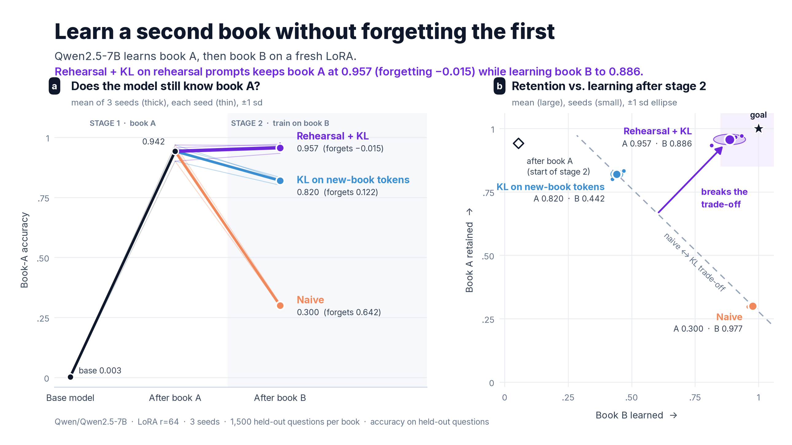
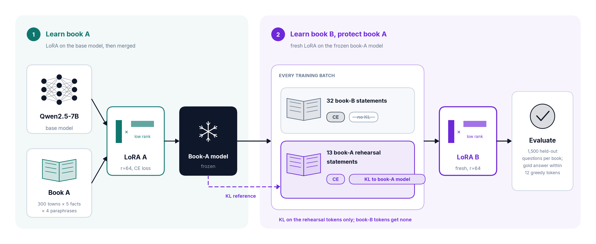
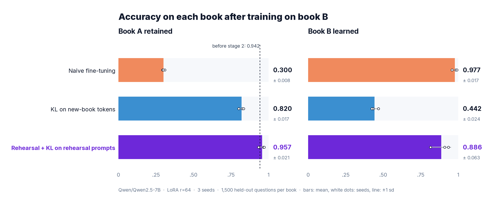
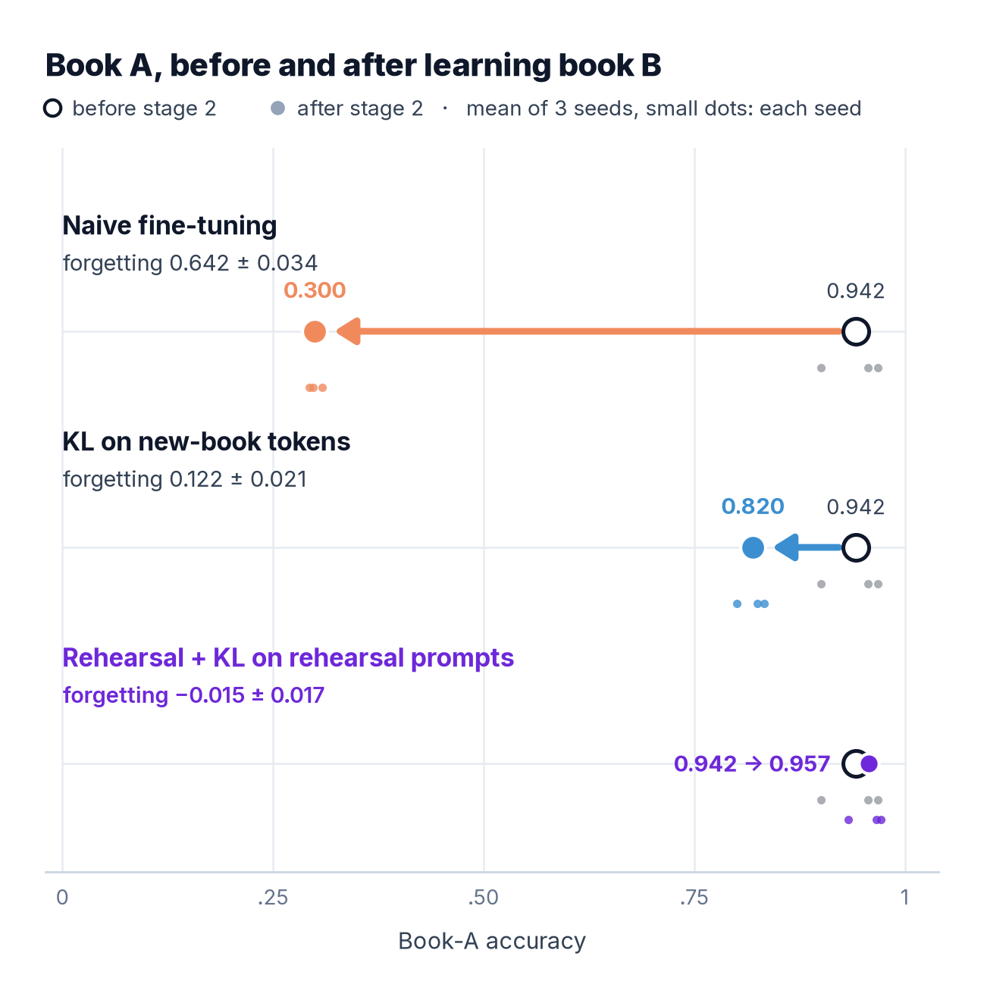
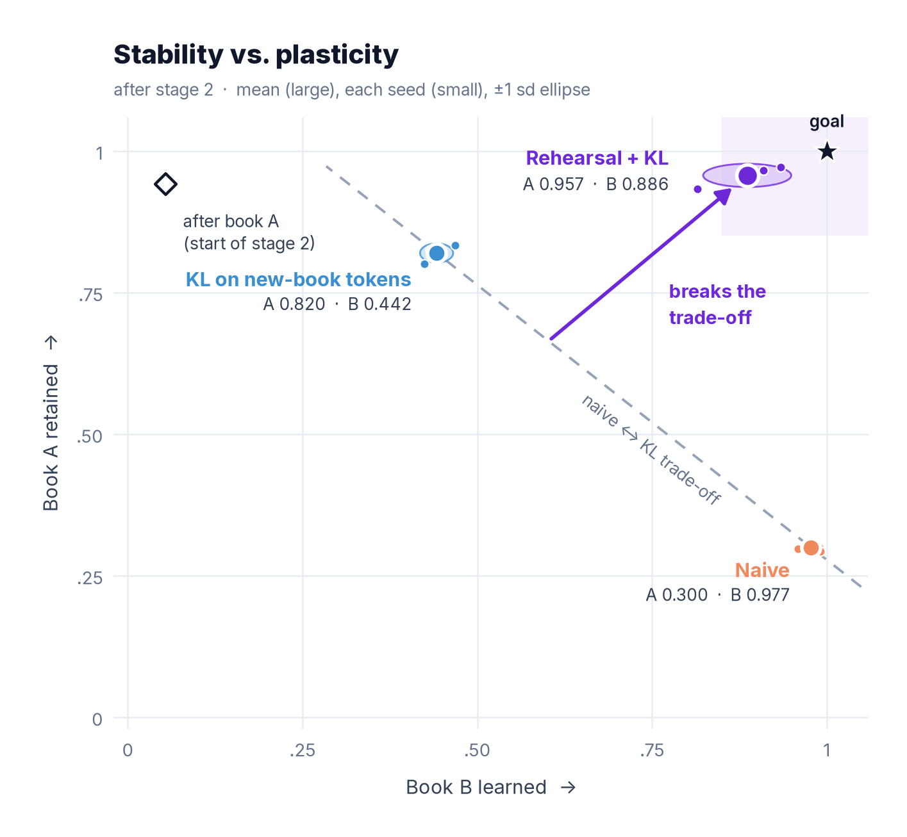
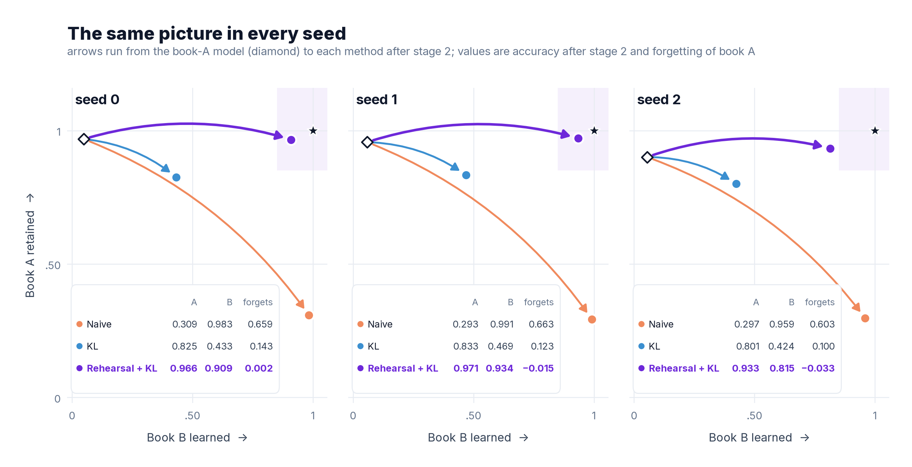

<div align="center">

# Sequential Books

**Teaching Qwen2.5-7B a second book without making it forget the first.**

[](https://www.python.org/)
[](https://pytorch.org/)
[](https://huggingface.co/Qwen/Qwen2.5-7B)
[](https://github.com/huggingface/peft)
[](LICENSE)



</div>

A small, fully reproducible experiment on catastrophic forgetting in sequential fine-tuning. A 7B model learns
book A, then a closely related book B on a fresh LoRA adapter. We measure how much of book A survives. A simple
recipe, **rehearsal of book A plus a KL penalty to the book-A model on the rehearsal examples only**, showed no
measurable forgetting of book A in any of the three seeds (−0.033 to +0.002) while learning most of book B.

## TL;DR

Qwen2.5-7B, LoRA r=64, 3 seeds, mean ± sd, 1,500 held-out questions per book.

| | Book A after stage 2 | Book B after stage 2 | Forgetting of A ↓ |
|---|:---:|:---:|:---:|
| Naive fine-tuning | 0.300 ± 0.008 | **0.977 ± 0.017** | 0.642 ± 0.034 |
| KL on new-book tokens | 0.820 ± 0.017 | 0.442 ± 0.024 | 0.122 ± 0.021 |
| **Rehearsal + KL on rehearsal prompts** | **0.957 ± 0.021** | 0.886 ± 0.063 | **−0.015 ± 0.017** |

- Starting point: the base model scores A 0.003 / B 0.004. After stage 1 (book A) it scores **A 0.942 ± 0.036**, B 0.054.
- **Naive** fine-tuning on book B learns it almost perfectly but drops book A from 0.942 to **0.300**.
- **KL on new-book tokens** keeps more of A (0.820) but learns only **0.442** of B: it pins the very tokens that
  need to change.
- **Rehearsal + KL on rehearsal prompts** keeps A at **0.957** (no measurable forgetting) and reaches **0.886** on B.
  It still trails naive on B by about 0.09 and varies more across seeds.
- All 9 stage-2 runs together took **about 1 GPU-hour on one NVIDIA L40S**.

> **Scope.** This is a toy, synthetic proof of concept on a base model with lenient scoring and no tuning. It shows
> the mechanism, not performance on real books. See [Limitations](#limitations).

## The problem

You fine-tune a model on one body of knowledge ("book A"), then on a second, related one ("book B"). The second
fine-tune overwrites the first: **catastrophic forgetting**. The two books here share the same schema, sentence
shapes and answer vocabulary (only the towns differ), so they compete for the same weights. This is the hard case for most
forgetting fixes.

Every method has to manage the **stability-plasticity trade-off**:

- **Stability**: keep what the model said about book A.
- **Plasticity**: still be free to learn new answers for book B.

Constraints that act on book-B inputs (for example a KL penalty to the old model on the new data) buy stability
by giving up plasticity. The question this repo asks is whether we can put the constraint **only where book A
lives** and leave book-B tokens free.

## Method

Two stages, each a LoRA adapter (r=64, alpha=128, on all attention and MLP projections).

1. **Stage 1.** Train LoRA A on book-A text with cross-entropy, then merge it. The merged model is the
   **book-A model**. It stays frozen and acts as the KL reference in stage 2.
2. **Stage 2.** Add a **fresh LoRA B** on top of the book-A model. Every batch holds 32 book-B statements plus
   13 rehearsal statements from book A (`--replay_ratio 0.4` of the batch size, added on top):

```text
loss =          CE( book-B statements )             # new knowledge, no constraint
     +          CE( book-A rehearsal statements )   # positive target for the old knowledge
     + kl_w ·   KL( p_book-A-model ‖ p_model )      # on the rehearsal tokens only
```

The KL reference is the book-A model itself, obtained by disabling the stage-2 adapter, so it needs no second
copy of the weights. `kl_w = 1.0`. **No KL is applied to book-B tokens.**

<p align="center"></p>

### Methods compared

| Method (code name) | Stage-2 loss |
|---|---|
| Naive fine-tuning (`naive`) | CE on book B |
| KL on new-book tokens (`kl_global`) | CE on book B + `kl_w` · KL to the book-A model **on the same book-B tokens** |
| Rehearsal + KL on rehearsal prompts (`replay_kl`) | CE on book B + CE on book-A rehearsal + `kl_w` · KL to the book-A model **on the rehearsal tokens only** |

All three share the same stage-1 model per seed, the same fresh-LoRA setup, learning rate and number of steps.

## Setup and data

- **Two synthetic "books" of fictional towns.** Each book has 300 towns with invented names, so the base model
  cannot know them (base accuracy 0.003 / 0.004). Books A and B have no town names in common.
- **Shared schema.** Every town has the same 5 facts: founder, founding year, main export, river and yearly
  festival. Both books use the same sentence templates and the same small sets of exports and festivals, which
  makes them close-topic on purpose.
- **Training text.** 4 paraphrased statements per fact: 300 × 5 × 4 = **6,000 statements per book**, 4 epochs,
  batch 32, AdamW at lr 2e-4 with linear decay, bf16, gradient checkpointing.
- **Held-out evaluation.** Questions use a template that never appears in training
  (`Question: Who founded the town of X?\nAnswer:`). 300 × 5 = **1,500 questions per book**.
- **Scoring.** Greedy decoding for 12 new tokens. An answer is correct if the gold string appears anywhere in the
  output, case-insensitive. This is lenient on purpose; see Limitations.
- **Seeds.** 0, 1 and 2. The books are fixed; the seed changes the data order and the LoRA initialization.
- **Forgetting of A** = accuracy on A after stage 1 − accuracy on A after stage 2. Negative means book A improved.

## Results

<p align="center"></p>

| Method | Seeds | A after stage 1 | A after stage 2 | B after stage 2 | Forgetting of A |
|---|:---:|:---:|:---:|:---:|:---:|
| Naive fine-tuning | 3 | 0.942 ± 0.036 | 0.300 ± 0.008 | 0.977 ± 0.017 | 0.642 ± 0.034 |
| KL on new-book tokens | 3 | 0.942 ± 0.036 | 0.820 ± 0.017 | 0.442 ± 0.024 | 0.122 ± 0.021 |
| Rehearsal + KL on rehearsal prompts | 3 | 0.942 ± 0.036 | **0.957 ± 0.021** | 0.886 ± 0.063 | **−0.015 ± 0.017** |

Mean ± sd over seeds (sample sd). Source: [`results/summary.md`](results/summary.md) and
[`results/results.csv`](results/results.csv).

<table>
<tr>
<td width="50%"></td>
<td width="50%"></td>
</tr>
</table>

**Reading the trade-off plot.** The top-right corner is the goal: keep A and learn B. Naive sits at the bottom
right (learns B, loses A). KL on new-book tokens moves up but also far to the left: protecting A this way costs
most of B. Rehearsal + KL on rehearsal prompts lands closest to the ideal corner in every seed, though seed 2 learns
less of book B (0.815) than seeds 0 and 1.

**Why might this be?** Our reading, which this toy experiment is consistent with but does not prove: book-B
tokens are exactly the ones that must change, so a KL penalty on them fights learning. Rehearsal gives the model
a positive target for book A, and the KL on the rehearsal tokens keeps its book-A predictions close to the
book-A model, while book-B tokens get no penalty.

### Per-seed results

<p align="center"></p>

| Method | Seed | A after stage 1 | A after stage 2 | B after stage 2 | Forgetting of A | Stage-2 time (min) |
|---|:---:|:---:|:---:|:---:|:---:|:---:|
| Naive | 0 | 0.968 | 0.309 | 0.983 | 0.659 | 4.8 |
| Naive | 1 | 0.957 | 0.293 | 0.991 | 0.663 | 4.8 |
| Naive | 2 | 0.901 | 0.297 | 0.959 | 0.603 | 4.9 |
| KL on new-book tokens | 0 | 0.968 | 0.825 | 0.433 | 0.143 | 5.7 |
| KL on new-book tokens | 1 | 0.957 | 0.833 | 0.469 | 0.123 | 5.7 |
| KL on new-book tokens | 2 | 0.901 | 0.801 | 0.424 | 0.100 | 5.8 |
| Rehearsal + KL on rehearsal prompts | 0 | 0.968 | 0.966 | 0.909 | 0.002 | 9.3 |
| Rehearsal + KL on rehearsal prompts | 1 | 0.957 | 0.971 | 0.934 | −0.015 | 9.5 |
| Rehearsal + KL on rehearsal prompts | 2 | 0.901 | 0.933 | 0.815 | −0.033 | 9.6 |

Book B after stage 1 (before any book-B training) was 0.049, 0.059 and 0.054 for seeds 0, 1 and 2. Some of this
is likely lucky guesses, since exports and festivals come from small shared lists.

## Cost

Stage-2 wall-clock time from `results/results.csv` (training plus evaluation of both books), one NVIDIA L40S
(48 GB), bf16:

| Method | Per run (mean) | 3 seeds |
|---|:---:|:---:|
| Naive fine-tuning | 4.9 min | 14.6 min |
| KL on new-book tokens | 5.7 min | 17.2 min |
| Rehearsal + KL on rehearsal prompts | 9.4 min | 28.3 min |
| **All stage-2 runs** | | **≈ 1.0 GPU-hour** |

Rehearsal + KL costs about 1.9× a naive run: each step adds a 13-example rehearsal forward/backward pass and a
reference forward pass. Stage 1 and the base-model evaluation are not timed in the CSV and are not included.

## Limitations

Please read these before drawing conclusions.

- **Toy, synthetic data.** Templated facts about fictional towns, five attributes, short answers. Real books
  have long-form, overlapping and sometimes conflicting knowledge. Nothing here is a claim about real data.
- **Base model, not an instruction-tuned model.** No chat template, no general-skill or safety evaluation.
  We did not measure whether general abilities degrade.
- **Lenient scoring.** Substring match on 12 greedy tokens. It can credit partial or rambling answers, and
  small answer sets (exports, festivals) allow lucky guesses.
- **No tuning.** One configuration (`--kl_w 1.0`, `--replay_ratio 0.4`, lr 2e-4, 4 epochs) for every method. A
  tuned KL weight might give "KL on new-book tokens" a better trade-off; we have not tested that.
- **Book B trails naive.** 0.886 ± 0.063 against 0.977 ± 0.017, with the largest seed-to-seed spread (0.815 to 0.934).
- **Rehearsal used the original book-A text.** In many real settings the first book's source text is not
  available at stage 2. This experiment does not show what happens without it.
- **Small scale.** 3 seeds, one model, one pair of books.

## Next steps

- **On-policy rehearsal from the model's own answers.** Replace the original book-A text with the book-A model's
  own greedy answers to book-A questions, trained with CE plus KL to the book-A model on those prompts only. This
  removes the need for the original text, which is the main gap above.
- **KL to the base model for general skills.** Add a small set of everyday instructions with a KL penalty toward
  the base model, and measure general benchmarks before and after.
- **Tune the replay ratio and KL weight**, with the aim of closing the book-B gap to naive without losing book A,
  and sweep the KL weight for the KL-on-new-book-tokens baseline too.
- Stricter scoring (exact match or a judge), per-attribute breakdowns, more seeds, and an instruction-tuned model.

## Quick start

Clone the repository and run on CPU first. Building the data needs no GPU and no PyTorch:

```bash
git clone https://github.com/antonio-mastropaolo/qwen-sequential-books
cd qwen-sequential-books
python sequential_books.py --dry_run          # builds both books, prints sizes and examples
```

Expected output starts with `book A: 6000 train stmts, 1500 eval Qs | book B: 6000 / 1500`.

Full pipeline smoke test on CPU (tiny model, a few steps; checks the pipeline, not results):

```bash
MODEL=HuggingFaceTB/SmolLM2-135M bash setup.sh # venv in ~/venvs/seqbooks, pinned deps, small model only
. ~/venvs/seqbooks/bin/activate
TINY=1 bash run_all.sh                         # SmolLM2-135M, 8 towns, 6 steps per stage -> results_smoke/
```

## Reproduce the results

On one 48 GB GPU (for example an L40S or A6000):

```bash
bash setup.sh                                  # venv in ~/venvs/seqbooks, pinned deps, downloads Qwen2.5-7B (~15 GB)
. ~/venvs/seqbooks/bin/activate
bash run_all.sh                                # 3 methods x seeds 0 1 2 -> results/ (JSON per run, CSV, summary)
python assets/make_figures.py                  # rebuilds every figure in assets/ from results/results.csv
```

Useful variations:

```bash
SEEDS="0 1" bash run_all.sh                                    # fewer seeds
MODEL=Qwen/Qwen2.5-0.5B OUT=results_05b bash run_all.sh        # another model, separate output dir
EXTRA="--wandb" bash run_all.sh                                # log to Weights & Biases (bash setup.sh --wandb)

# a single method and seed, with a different replay ratio and KL weight
python sequential_books.py --model Qwen/Qwen2.5-7B --seed 0 --methods replay_kl \
    --replay_ratio 0.25 --kl_w 0.5 --out results_sweep
python make_report.py --dir results_sweep                      # results.csv, summary.md, forgetting.png
```

Main flags of `sequential_books.py`: `--model`, `--tiny`, `--methods` (comma list of `naive,kl_global,replay_kl`),
`--seed`, `--n_entities` (300), `--epochs` (4) / `--max_steps`, `--bs` (32), `--eval_bs` (64), `--lr` (2e-4),
`--lora_r` (64), `--kl_w` (1.0), `--replay_ratio` (0.4), `--dtype` (`auto|bf16|fp16|fp32`), `--no_grad_ckpt`,
`--wandb`, `--dry_run`, `--out`.

## Repository layout

```text
.
├── sequential_books.py     # data generation, two-stage LoRA training, the three methods, evaluation
├── make_report.py          # result JSONs -> results.csv, summary.md, forgetting.png
├── run_all.sh              # all methods x seeds, then the report (env: MODEL, SEEDS, OUT, EXTRA, TINY)
├── setup.sh                # venv, pinned dependencies, model download
├── requirements.txt
├── results/
│   ├── results.csv         # per-seed numbers behind every table and figure
│   ├── summary.md          # mean ± sd table
│   └── forgetting.png      # accuracy across stages (from make_report.py)
├── assets/
│   ├── make_figures.py     # builds every README figure from results/results.csv
│   ├── hero.png  accuracy_bars.png  forgetting.png  tradeoff.png  per_seed.png
│   └── method.png  (every figure also as .svg)
├── CITATION.cff
└── LICENSE
```

## Citation

If you use this code or these results, please cite:

```bibtex
@misc{mastropaolo2026sequentialbooks,
  author       = {Antonio Mastropaolo},
  title        = {Sequential Books: Learning a Second Book without Forgetting the First in {Qwen2.5-7B}},
  year         = {2026},
  howpublished = {GitHub repository},
  url          = {https://github.com/antonio-mastropaolo/qwen-sequential-books},
  note         = {Rehearsal with KL to the previous model on rehearsal examples only, for sequential LoRA fine-tuning}
}
```

## License

[MIT](LICENSE) © 2026 Antonio Mastropaolo

---

<p align="center"><b>Antonio Mastropaolo</b> · AURA Lab, William &amp; Mary</p>
