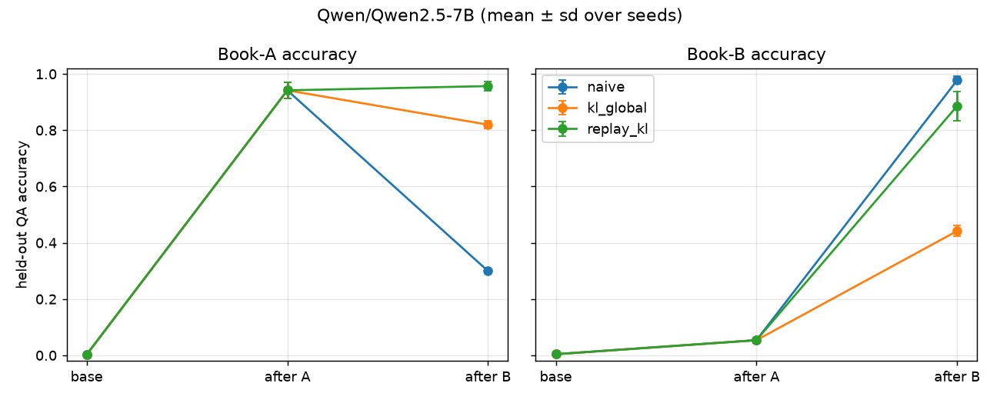

# sequential-books

Teach an LLM (Qwen2.5-7B, LoRA) the facts in "book A", then a closely related "book B", and measure how much of A it forgets.

## Setup

- **Data.** Two synthetic books of N fictional river towns (default 300), five facts each: founder, year, export, river, festival. Same schema in both books, so the topics overlap; town names are disjoint. Data is fixed by seed.
- **Train/eval.** Training uses 4 paraphrased statements per fact (6,000 per book). Eval uses held-out question templates (1,500 per book); correct if 12 greedy tokens contain the gold answer.
- **Stage 1.** LoRA (r=64, all attention + MLP projections) on book A, merged. Run once per seed, shared by all methods.
- **Stage 2.** Fresh LoRA on the book-A model, trained on book B, then removed so every method starts from the same weights.

| method | stage-2 loss |
|---|---|
| `naive` | CE on book B |
| `kl_global` | CE on book B + KL(book-A model ‖ model) on book-B tokens |
| `replay_kl` | CE on book B + CE on book-A training statements + KL only on those rehearsal tokens |

The KL reference is the same network with the adapter off. Rehearsal never touches eval questions.
Forgetting = acc_A(after A) − acc_A(after B).

## Why global KL and null-space projection struggle here

Both books share the same sentence shapes, so they use mostly the same directions in the network. Global KL pins the model to the book-A model's predictions on exactly the book-B tokens that need to change, and says little about book-A questions. Null-space projection removes the shared directions, which leaves almost no room to write B. Rehearsal + KL on book-A prompts puts the constraint where it matters and leaves the B tokens free. These are hypotheses the benchmark tests, not results.

## Results

Qwen/Qwen2.5-7B, 3 seeds (0, 1, 2), mean ± sd, from `results/summary.md` (per-seed numbers in `results/results.csv`).
Total run time was about 1–2 GPU hours on one L40S (48 GB).

Base: A=0.003, B=0.004. After stage 1 (book A): A=0.942, B=0.054.

| method | seeds | A after A | A after B | B after B | forgetting of A |
|---|---|---|---|---|---|
| naive | 3 | 0.942 ± 0.036 | 0.300 ± 0.008 | 0.977 ± 0.017 | 0.642 ± 0.034 |
| kl_global | 3 | 0.942 ± 0.036 | 0.820 ± 0.017 | 0.442 ± 0.024 | 0.122 ± 0.021 |
| replay_kl | 3 | 0.942 ± 0.036 | 0.957 ± 0.021 | 0.886 ± 0.063 | -0.015 ± 0.017 |



**Caveats.**
- This is a quick proof of concept on synthetic toy data (fictional towns, five templated facts each). It says nothing
  definitive about real books, real QA formats, or other models.
- Only 3 seeds, default hyperparameters (`--kl_w 1.0`, `--replay_ratio 0.4`), no tuning.
- `replay_kl` removed forgetting of book A here, but book-B accuracy (0.886) still trails naive (0.977) and has the
  highest variance. Tuning the replay ratio and KL weight is the obvious next step.
- `kl_global` protects A partly but learns B poorly, consistent with the hypothesis above, not a proof of it.
- Accuracy is substring match on 12 greedy tokens, a lenient metric.

## Reproduce (one 48 GB GPU, e.g. L40S / A6000)

```bash
bash setup.sh                         # venv in ~/venvs/seqbooks, pinned deps, downloads Qwen2.5-7B
. ~/venvs/seqbooks/bin/activate
bash run_all.sh                       # 3 methods x seeds 0 1 2 -> results/
# SEEDS="0 1" bash run_all.sh ; EXTRA="--wandb" bash run_all.sh ; MODEL=Qwen/Qwen2.5-0.5B OUT=results_05b bash run_all.sh
```

CPU smoke test (pipeline check only, not results): `TINY=1 bash run_all.sh` (SmolLM2-135M, 8 towns, 6 steps per stage).

Main flags: `--model --tiny --methods --seed --n_entities --epochs/--max_steps --bs --lr --lora_r --kl_w --replay_ratio --dtype --wandb --out`.

TODO: per-attribute breakdown, relaxed null-space ablation, replay-ratio / KL-weight sweep.

## License

MIT
